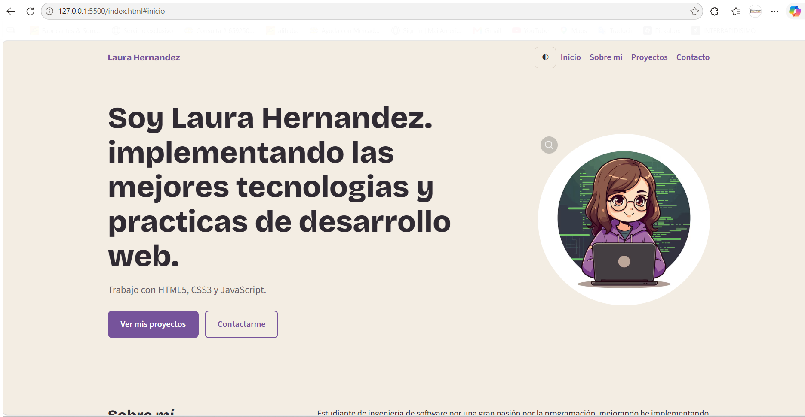
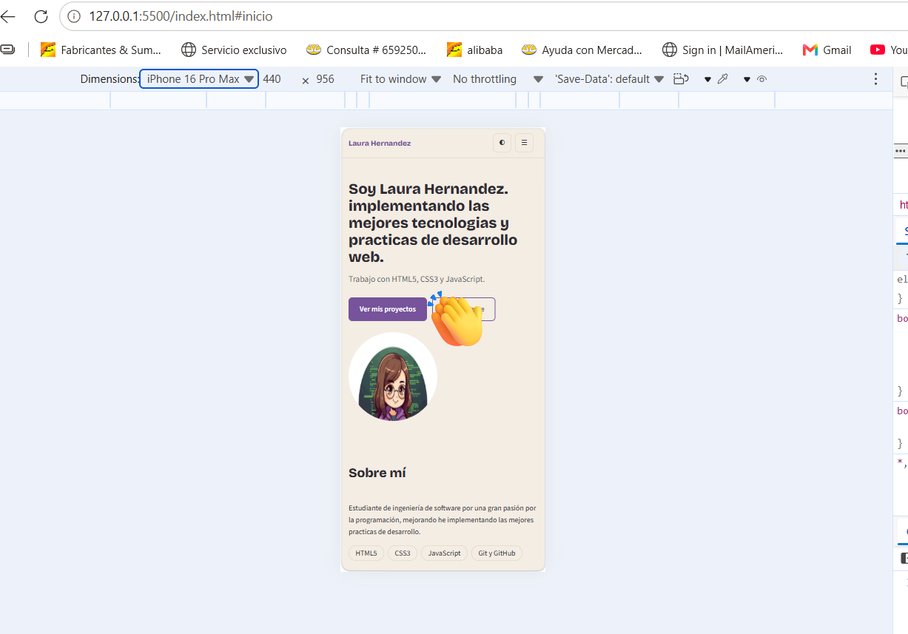

# Mi Portafolio Web Interactivo

Portafolio personal de un desarrollador web, hecho para demostrar los conocimientos adquiridos: HTML5, CSS3 responsivo y JavaScript.

🔗 **Sitio en vivo:** https://github.com/lvhernandezo99/portafolioLVH.git

## Descripción

El sitio presenta quién soy, lista mis proyectos y ofrece un formulario de contacto con validación en tiempo real y envío simulado. Se adapta a móvil, tablet y escritorio, y permite cambiar entre tema claro y oscuro.

## Tecnologías utilizadas

- **HTML5**: etiquetas semánticas, metaetiquetas y formulario con validaciones nativas.
- **CSS3**: Flexbox, Grid, variables CSS, media queries mobile-first y transiciones.
- **JavaScript (ES Modules)**: manipulación del DOM, eventos, `localStorage` e `IntersectionObserver`.
- **Git y GitHub Pages**: control de versiones y despliegue.
- **Google Fonts**: Bricolage Grotesque y Source Sans 3.

## Instalación y ejecución local

```bash
git clone https://github.com/TU-USUARIO/mi-portafolio.git
cd mi-portafolio
```
Los módulos de JavaScript necesitan un servidor local, así que no abras `index.html` con doble clic. Puedes usar la siguiente opcion:
- La extensión **Live Server** de VS Code (clic derecho en `index.html` → *Open with Live Server*).

## Estructura del proyecto

```
mi-portafolio/
├── index.html
├── css/        reset.css · variables.css · layout.css · components.css
├── js/         main.js · form-handler.js · animations.js
├── assets/     images
├── docs/       entregables.md · wireframe.svg
└── README.md
```

## Capturas de pantalla



## Autor

**Laura valentina hernandez ortiz**: [GitHub](https://github.com/lvhernandezo99) · lauravalentinahernandezortiz@fumc.edu.co

Distribuido bajo la licencia MIT. Uso educativo.
